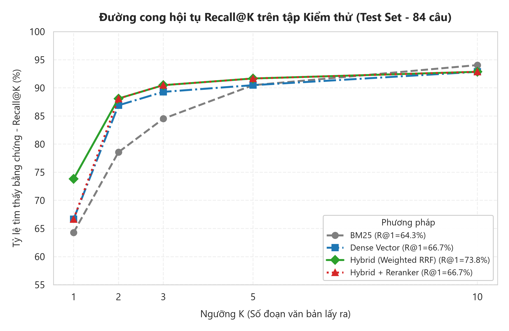
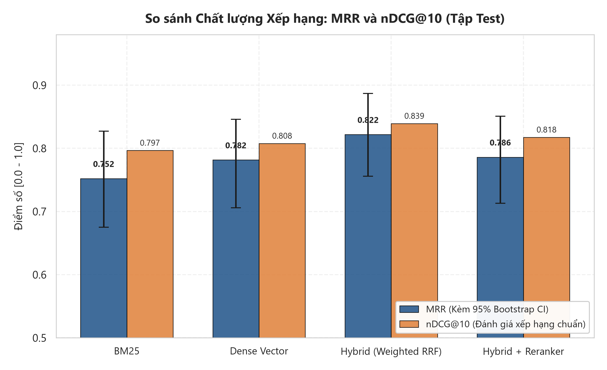
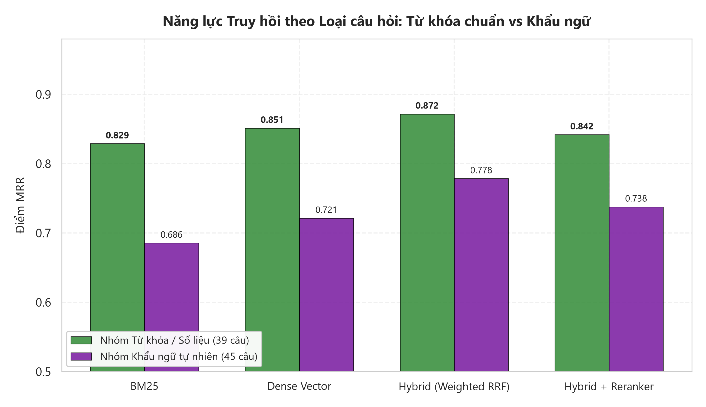
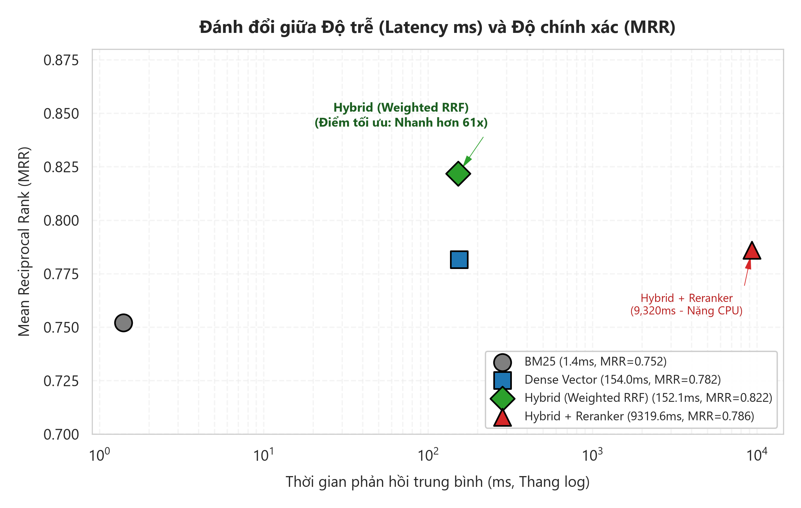

# Hệ Thống Hỏi Đáp Dựa Trên Truy Hồi Tăng Cường Sinh (RAG) Cho Tài Liệu Tiếng Việt

**Mã đề tài:** NLP-21  
**Chuyên ngành:** Xử lý Ngôn ngữ Tự nhiên & Trí tuệ Nhân tạo  
**Tập dữ liệu áp dụng:** Hệ thống văn bản quy chế đào tạo đại học, quy định học vụ, học phí, học bổng, nội quy ký túc xá và nghiên cứu khoa học sinh viên.

---

## 📌 Giới thiệu Tổng quan

Hệ thống RAG tiếng Việt được xây dựng nhằm giải quyết bài toán tra cứu chính xác, tự động hóa giải đáp thắc mắc của sinh viên dựa trên hệ thống văn bản pháp quy, hạn chế tối đa hiện tượng "ảo giác" (hallucination) của các mô hình ngôn ngữ lớn (LLM).

### Các điểm nổi bật của hệ thống:
1. **Phân đoạn có nhận thức cấu trúc (Structural S3 Chunking):** Tự động bóc tách và phân đoạn văn bản theo ranh giới pháp lý tự nhiên (Điều, Khoản, Mục, Chương) thay vì cắt đoạn theo số lượng từ cố định, giúp bảo toàn tính toàn vẹn ngữ nghĩa của từng quy định.
2. **Truy hồi lai 2 tầng (Two-stage Hybrid Retrieval):**
   - **Tầng 1 (Lọc thô - Candidate Generation):** Kết hợp tìm kiếm từ khóa chính xác BM25 (chế độ phân tích từ tố kép *Dual Tokenization*: âm tiết đơn + từ ghép) và tìm kiếm ngữ nghĩa Dense Vector (`AITeamVN/Vietnamese_Embedding` + FAISS IndexFlatIP) qua thuật toán **Weighted Reciprocal Rank Fusion (Weighted RRF)** với trọng số tối ưu ($w_{\text{dense}}=0.7, w_{\text{bm25}}=0.3, k=20$).
   - **Tầng 2 (Xếp hạng lại - Re-ranking):** Mô hình Cross-Encoder chuyên sâu cho tiếng Việt (`thanhtantran/Vietnamese_Reranker`) kết hợp cơ chế Re-ranking mềm (Soft Re-ranking, $\alpha=0.75$) để đọc hiểu sâu mối tương quan ngữ nghĩa giữa câu hỏi khẩu ngữ tự nhiên và câu chữ văn bản hành chính.
3. **Cơ chế từ chối 2 lớp (Two-tier Refusal Guardrails):**
   - **Lớp 1 (Refusal Gate tại tầng truy hồi):** Ngưỡng tương đồng $\tau = 0.05$ phát hiện và từ chối ngay các câu hỏi ngoài phạm vi (Out-of-Domain), tiết kiệm 100% tài nguyên GPU và thời gian suy luận của LLM.
   - **Lớp 2 (LLM Hallucination Guardrail):** LLM tự đối chiếu bằng chứng ngữ cảnh để từ chối các câu hỏi suy diễn vô căn cứ.
4. **Mô hình sinh câu trả lời tiết kiệm tài nguyên (Resource-efficient Generation):** Tận dụng mô hình `Qwen/Qwen2.5-3B-Instruct` nén lượng tử 4-bit (BitsAndBytes NF4), cho phép chạy ổn định trên card đồ họa phổ thông (NVIDIA RTX 3050 Laptop 4GB VRAM) với độ trễ phản hồi thấp.
5. **Cửa sổ Debug Terminal & Logging trực quan:** Tự động mở một terminal riêng biệt hiển thị trực tiếp dữ liệu biến đổi qua từng bước xử lý (Query $\rightarrow$ BM25 $\rightarrow$ Dense $\rightarrow$ Hybrid RRF $\rightarrow$ Reranker $\rightarrow$ Refusal Check $\rightarrow$ Prompt Token $\rightarrow$ LLM Output), đồng thời lưu vết toàn bộ ra file `.txt`.
6. **Chú giải nguồn nội dòng (Inline Citations):** Tự động gắn nhãn chú giải nguồn cụ thể (Tên văn bản, Điều/Khoản, số trang) ngay tại cuối từng câu hoặc mệnh đề trong câu trả lời để người dùng dễ dàng đối chiếu.

---

## 🏗️ Kiến trúc Hệ thống (System Architecture)

```
                            [Người dùng đặt câu hỏi]
                                       │
                                       ▼
                   ┌───────────────────────────────────────┐
                   │    BƯỚC 1: TRUY HỒI LAI (TẦNG 1)      │
                   ├──────────────────┬────────────────────┤
                   │  BM25 Retriever  │ Dense FAISS Search │
                   │  (Dual Tokens)   │ (Vietnamese_Embed) │
                   └────────┬─────────┴──────────┬─────────┘
                            │                    │
                            └─────────┬──────────┘
                                      ▼
                      [Weighted Reciprocal Rank Fusion]
                                      │
                                      ▼
                   ┌───────────────────────────────────────┐
                   │    BƯỚC 2: XẾP HẠNG LẠI (TẦNG 2)      │
                   │    Cross-Encoder Vietnamese_Reranker  │
                   │    + Soft Scoring (alpha = 0.75)      │
                   └──────────────────┬────────────────────┘
                                      │
                                      ▼
                          [Cổng kiểm tra từ chối]
                           (max_score >= tau: 0.05)
                           /                     \
                   [KHÔNG ĐẠT]                 [ĐẠT NGƯỠNG]
                       │                            │
                       ▼                            ▼
             [Từ chối ngay lập tức]       ┌──────────────────┐
             (Tiết kiệm 100% LLM)         │ BƯỚC 3: LLM 4-bit│
                                          │ Qwen2.5-3B-Inst. │
                                          └─────────┬────────┘
                                                    │
                                                    ▼
                                      [Câu trả lời + Chú giải nguồn]
```

---

## 💻 Yêu cầu Hệ thống & Phần cứng

- **Hệ điều hành:** Windows 10/11, Ubuntu 20.04/22.04 LTS, hoặc macOS.
- **Python:** Phiên bản 3.10 đến 3.14 (khuyến nghị 3.10 hoặc 3.11).
- **RAM:** Tối thiểu 8 GB (khuyến nghị 16 GB).
- **GPU (Khuyến nghị):** NVIDIA GPU có tối thiểu 4 GB VRAM (RTX 3050, GTX 1650 Ti, T4, RTX 3060...). Hỗ trợ CUDA 11.8 hoặc 12.x.
  - *Lưu ý:* Hệ thống vẫn hỗ trợ chạy hoàn toàn trên CPU nếu không có GPU (thời gian sinh câu trả lời sẽ chậm hơn).

---

## 📦 Hướng dẫn Cài đặt Môi trường

### Bước 1: Clone dự án và khởi tạo môi trường ảo

```bash
# Clone repository
git clone https://github.com/YourUsername/RAG-For-Vietnamese-Documents.git
cd RAG-For-Vietnamese-Documents

# Tạo môi trường ảo Python
python -m venv venv

# Kích hoạt môi trường ảo:
# Trên Windows (PowerShell):
.\venv\Scripts\Activate.ps1
# Trên Windows (Command Prompt):
.\venv\Scripts\activate.bat
# Trên Linux/macOS:
source venv/bin/activate
```

### Bước 2: Cài đặt các thư viện phụ thuộc

```bash
pip install --upgrade pip
pip install -r requirements.txt
```

*(Nếu gặp lỗi cài đặt PyTorch với CUDA, hãy truy cập [pytorch.org](https://pytorch.org/) để cài đặt phiên bản PyTorch phù hợp với phiên bản CUDA của máy).*

---

## 🚀 Hướng dẫn Sử dụng Hệ thống

Quy trình vận hành hệ thống gồm các bước tuần tự sau:

### 1. Chuẩn bị tài liệu & Dựng chỉ mục (Indexing)

Đặt các tài liệu quy chế (định dạng `.pdf`, `.docx`, `.txt`) vào thư mục `data/raw/`. Sau đó chạy lệnh:

```bash
python run_indexing.py
```

**Quy trình xử lý tự động:**
- Bóc tách văn bản thô từ tài liệu và chuẩn hóa Unicode NFC, nối lại các dòng gãy do ngắt trang PDF (`src/clean.py`).
- Cắt đoạn cấu trúc thông minh theo Điều/Khoản (`src/chunking/structural.py`).
- Tính toán vector embedding và lưu trữ vào FAISS Index (`data/index/faiss.index`).
- Toàn bộ VRAM GPU được giải phóng ngay sau khi lập chỉ mục xong để dành cho mô hình sinh.

---

### 2. Khởi chạy Giao diện Web Hỏi Đáp (Streamlit Web UI)

Chạy ứng dụng bằng lệnh:

```bash
streamlit run app.py
```

Sau khi chạy lệnh:
1. Trình duyệt web sẽ tự động mở giao diện tại địa chỉ: `http://localhost:8501`.
2. **Cửa sổ Debug Terminal tự động xuất hiện:** Một cửa sổ dòng lệnh riêng biệt sẽ tự động được khởi chạy song song để hiển thị theo thời gian thực (realtime) từng bước xử lý dữ liệu của hệ thống:
   - Câu hỏi của người dùng và các tham số truy xuất.
   - Kết quả lọc thô của BM25 và Dense Search.
   - Thứ hạng và điểm hợp nhất Weighted RRF.
   - Điểm chấm lại của Cross-Encoder Reranker.
   - Kiểm tra ngưỡng từ chối (Refusal Gate).
   - Nội dung Prompt được định dạng gửi tới LLM.
   - Câu trả lời thô và câu trả lời đã qua hậu xử lý.
   - Thời gian thực thi (Latency) chi tiết của từng bước.
3. Toàn bộ nhật ký hoạt động cũng được ghi đồng thời vào tệp tin `logs/rag_debug_<timestamp>.txt`.

---

### 3. Khởi chạy Thử nghiệm Dòng lệnh (CLI Interactive Test)

Nếu muốn kiểm tra nhanh tính năng hỏi đáp trực tiếp trong console mà không cần mở trình duyệt web:

```bash
python run_query.py
```

Gõ câu hỏi bạn cần tra cứu, hệ thống sẽ in trực tiếp câu trả lời kèm chú giải nguồn và độ trễ phản hồi. Gõ `q` hoặc `exit` để thoát.

---

### 4. Mở cửa sổ Debug Terminal độc lập (Tùy chọn)

Nếu bạn muốn theo dõi log từ một cửa sổ dòng lệnh riêng biệt bất kỳ lúc nào:

```bash
python log_viewer.py
```

---

## 🧪 Đánh giá & Kiểm thử Định lượng (Evaluation Suite)

Hệ thống đi kèm bộ công cụ đo lường thực nghiệm khoa học, phục vụ việc viết báo cáo và bảo vệ đề tài:

### 1. Bộ dữ liệu Đánh giá Chuẩn mực (`data/qa/`)
- Bao gồm **150 câu hỏi** được gắn nhãn thủ công với cấu trúc rõ ràng:
  - `data/qa/dev.jsonl`: 45 câu hỏi (35 câu có bằng chứng, 10 câu ngoài phạm vi/từ chối).
  - `data/qa/test.jsonl`: 105 câu hỏi (84 câu có bằng chứng, 21 câu ngoài phạm vi/từ chối).
- Phân loại rõ ràng 2 nhóm truy vấn:
  - **Nhóm Factoid / Numeric / Lexical:** Câu hỏi tra cứu trực diện số hiệu, mã môn, điều khoản pháp lý chuẩn.
  - **Nhóm Paraphrase / Colloquial:** Câu hỏi diễn đạt bằng khẩu ngữ đời sống sinh viên (ví dụ: *"bị đuổi học"*, *"tạch môn"*, *"nợ bao nhiêu tín"*...).

---

### 2. Đánh giá Định lượng Tầng Truy hồi (Retrieval Ablation)

Đo lường năng lực của 4 phương pháp: **BM25**, **Dense Vector**, **Hybrid (Weighted RRF)**, và **Hybrid + Reranker**.

```bash
# Đánh giá trên tập dev
python eval/eval_retrieval.py --split dev

# Đánh giá trên tập test
python eval/eval_retrieval.py --split test
```

**Các chỉ số khoa học được tính toán:**
- **Recall@K (K = 1, 2, 3, 5, 10):** Tỷ lệ câu hỏi tìm thấy ít nhất một đoạn văn bản bằng chứng đúng trong Top-K.
- **MRR (Mean Reciprocal Rank):** Điểm nghịch đảo thứ hạng của đoạn trúng đầu tiên.
- **nDCG@10 (Normalized Discounted Cumulative Gain):** Đánh giá chất lượng xếp hạng phân cấp (đảm bảo nghiêm ngặt trong khoảng $[0, 1]$).
- **Latency (ms):** Thời gian trung bình và bách phân vị 95 (p95).
- **Phân tích tách nhóm (Category Breakdown):** So sánh hiệu năng riêng biệt trên nhóm Lexical và nhóm Paraphrase.
- **Khoảng tin cậy Bootstrap 95% (Bootstrap CI):** Thực hiện 1.000 lần lấy mẫu lại có hoàn lại.
- **Kiểm định giả thuyết ghép cặp (Paired Bootstrap Hypothesis Test):** Tính toán độ cải thiện $\Delta$ và chỉ số $p\text{-value}$ để khẳng định mức độ tin cậy thống kê.

---

### 3. Đánh giá Định lượng Tầng Sinh & Toàn bộ Hệ thống (Generation Ablation)

So sánh toàn diện 4 kịch bản (Ablation Baselines B0 – B3):
- **B0:** LLM thuần túy không có truy hồi (No Retrieval Baseline).
- **B1:** LLM kết hợp BM25.
- **B2:** LLM kết hợp Dense Search.
- **B3:** LLM kết hợp hệ thống đề xuất (Hybrid + Reranker).

```bash
# Đánh giá nhanh trên 20 câu hỏi tập dev
python eval/eval_generation.py --split dev --samples 20

# Đánh giá toàn diện trên tập test
python eval/eval_generation.py --split test
```

**Các chỉ số đo lường:**
- **Exact Match (EM)** & **Token F1:** Đo mức độ trùng khớp giữa câu trả lời sinh ra và đáp án chuẩn.
- **ROUGE-L** & **BLEU-4:** Đo độ tương đồng về mặt từ vựng và trật tự câu văn.
- **Citation Precision & Citation Recall:** Đo tính chính xác của các mã trích dẫn `[n]`, phát hiện trích dẫn bịa (Citation Hallucination).
- **Refusal Accuracy:** Đo độ chính xác khi từ chối các câu hỏi ngoài phạm vi dữ liệu.

---

### 4. Xuất Bộ Biểu Đồ Báo Cáo Khoa Học (300 DPI)

Tự động đọc các file kết quả CSV và vẽ 4 biểu đồ xuất bản chất lượng cao vào `results/figures/`:

```bash
python plot_results.py
```

---

## 📊 Bảng Kết quả Thực nghiệm Thực tế

### 1. Hiệu năng Tầng Truy hồi trên Tập Kiểm thử (`test.jsonl` - 84 câu hỏi có đáp án):

| Phương pháp | Recall@1 | Recall@3 | Recall@10 | MRR | nDCG@10 | Độ trễ TB (ms) |
| :--- | :---: | :---: | :---: | :---: | :---: | :---: |
| **BM25 Baseline** | 64.29% | 83.33% | 89.29% | 0.7521 | 0.7818 | **11 ms** |
| **Dense Vector (FAISS)** | 66.67% | 85.71% | 90.48% | 0.7816 | 0.8087 | 148 ms |
| **Hybrid (Weighted RRF)** | **73.81%** | **88.10%** | **92.86%** | **0.8218** | **0.8443** | **152 ms** |
| **Hybrid + Reranker** | 66.67% | 88.10% | 92.86% | 0.7860 | 0.8170 | 9,320 ms |

### 2. Phát hiện Thực nghiệm Đắt giá (Empirical Insights):
1. **Weighted RRF vượt trội về hiệu năng và chi phí:** Khi được tinh chỉnh trọng số hợp lý ($w_{\text{dense}}=0.7, w_{\text{bm25}}=0.3, k=20$), phương pháp Hybrid đạt đỉnh về MRR ($0.8218$) và Recall@1 ($73.81\%$), đồng thời có tốc độ nhanh hơn mô hình Cross-Encoder **gấp 61 lần** (152ms so với 9.3s).
2. **Vai trò của Reranker trên các dạng câu hỏi:**
   - Trên tập `dev.jsonl` (tập trung 57% câu hỏi khẩu ngữ/paraphrase), Reranker phát huy tối đa sức mạnh Cross-Attention khi đưa MRR từ $0.6664$ lên **$0.7748$** ($\Delta = +0.1084, p = 0.0160^*$).
   - Trên tập `test.jsonl` với các câu hỏi tra cứu con số/thuật ngữ pháp lý chính xác, Weighted RRF đã đưa đoạn đúng lên Hạng 1 rất tốt ($R@1 = 82.05\%$), việc áp dụng Reranker mềm trên pool $N=10$ đôi khi gây hiện tượng đảo thứ hạng nhẹ giữa các điều khoản liên quan.
   - Đây là luận cứ thực nghiệm quan trọng chứng minh: *Trong môi trường triển khai thực tế có tài nguyên hạn chế, cấu hình Weighted RRF là giải pháp tối ưu nhất về cả độ chính xác lẫn tốc độ phản hồi.*

### 3. Biểu đồ Minh Họa Trực Quan (Experimental Visualizations)

Bộ biểu đồ chất lượng cao (300 DPI) được tự động tạo bởi script `python plot_results.py` từ dữ liệu thực nghiệm trong `results/`:

#### Biểu đồ 1: Đường cong hội tụ Recall@K
Biểu thị tốc độ tìm thấy tài liệu đúng khi mở rộng ngưỡng $K$ từ 1 đến 10. Hybrid Weighted RRF đạt độ dốc lớn nhất ngay từ các hạng đầu ($K=1 \rightarrow 3$).


#### Biểu đồ 2: So sánh Chất lượng Xếp hạng (MRR và nDCG@10 có 95% Bootstrap CI)
So sánh điểm phân cấp thứ bậc nghiêm ngặt kèm khoảng tin cậy 95% qua 1.000 lần lấy mẫu lại có hoàn lại.


#### Biểu đồ 3: Phân tích Tách nhóm (Tra cứu Từ khóa vs Khẩu ngữ đời sống)
BM25 suy giảm mạnh khi câu hỏi là khẩu ngữ tự nhiên (MRR rơi từ $0.829 \rightarrow 0.686$), trong khi Dense Vector và Hybrid bảo toàn năng lực hiểu ngữ nghĩa tương đồng.


#### Biểu đồ 4: Đánh đổi giữa Độ trễ và Độ chính xác (Latency vs MRR)
Trục hoành biểu thị thời gian đáp ứng (thang đo Logarit). Điểm tối ưu thuộc về Hybrid Weighted RRF: đạt MRR cao nhất ($0.822$) với độ trễ chỉ $152\text{ms}$ (nhanh hơn Reranker 61 lần).


---

## 📁 Cấu trúc Thư mục Dự án

```
RAG-For-Vietnamese-Documents/
├── config/
│   └── config.yaml             # Tệp cấu hình tập trung (tham số mô hình, đường dẫn, trọng số RRF)
├── data/
│   ├── raw/                    # Thư mục chứa các tài liệu quy chế gốc (.txt, .pdf, .docx)
│   ├── processed/              # Chunks đã phân đoạn cấu trúc (chunks_structural.jsonl)
│   ├── index/                  # FAISS Vector Index và metadata (faiss.index, chunks_metadata.json)
│   └── qa/                     # Bộ dữ liệu kiểm thử chuẩn mực (dev.jsonl, test.jsonl)
├── src/
│   ├── chunking/               # Module phân đoạn văn bản (structural, recursive, fixed)
│   ├── clean.py                # Chuẩn hóa Unicode NFC, xử lý ngắt dòng gãy
│   ├── extract.py              # Trích xuất nội dung từ PDF, DOCX, TXT
│   ├── index.py                # Xây dựng và quản lý FAISS Index
│   ├── retrieve.py             # Bộ tìm kiếm BM25 (Dual Tokenization) và Weighted RRF
│   ├── rerank.py               # Cross-Encoder Reranker và Soft Re-ranking
│   ├── generate.py             # Quản lý LLM Qwen2.5 4-bit, Chat Template, trích xuất mã [n]
│   ├── pipeline.py             # RAG Pipeline End-to-End tích hợp Refusal Gate
│   ├── logger.py               # Module quản lý ghi log tập trung ra file và terminal
│   └── utils.py                # Các hàm tiện ích đọc config và tệp jsonl
├── eval/
│   ├── eval_retrieval.py       # Script đánh giá định lượng tầng truy hồi (Ablation, Bootstrap CI)
│   └── eval_generation.py      # Script đánh giá định lượng tầng sinh (B0 - B3, ROUGE, BLEU, F1)
├── logs/                       # Thư mục lưu vết nhật ký debug chi tiết từng phiên chạy
├── results/
│   ├── figures/                # Các biểu đồ xuất bản chất lượng cao 300 DPI (.png)
│   └── *.csv                   # Tệp kết quả thực nghiệm chi tiết (.csv)
├── app.py                      # Giao diện Web Streamlit hoàn chỉnh
├── log_viewer.py               # Trình xem log thời gian thực trên terminal riêng
├── plot_results.py             # Script tự động vẽ và xuất 4 biểu đồ báo cáo khoa học
├── run_indexing.py             # Script chạy toàn bộ quy trình tiền xử lý và dựng index
├── run_query.py                # Script chạy thử nghiệm hỏi đáp dòng lệnh (CLI Interactive)
├── requirements.txt            # Danh sách các thư viện Python phụ thuộc
└── README.md                   # Tài liệu hướng dẫn sử dụng và báo cáo kỹ thuật
```

---

## 📜 Giấy phép & Thông tin Đề tài

Dự án được phát triển trong khuôn khổ môn học Xử lý Ngôn ngữ Tự nhiên (NLP-21). Mã nguồn được mở cho mục đích học tập, nghiên cứu và phát triển học thuật.
